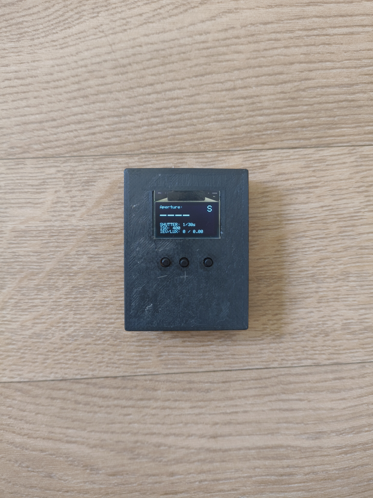
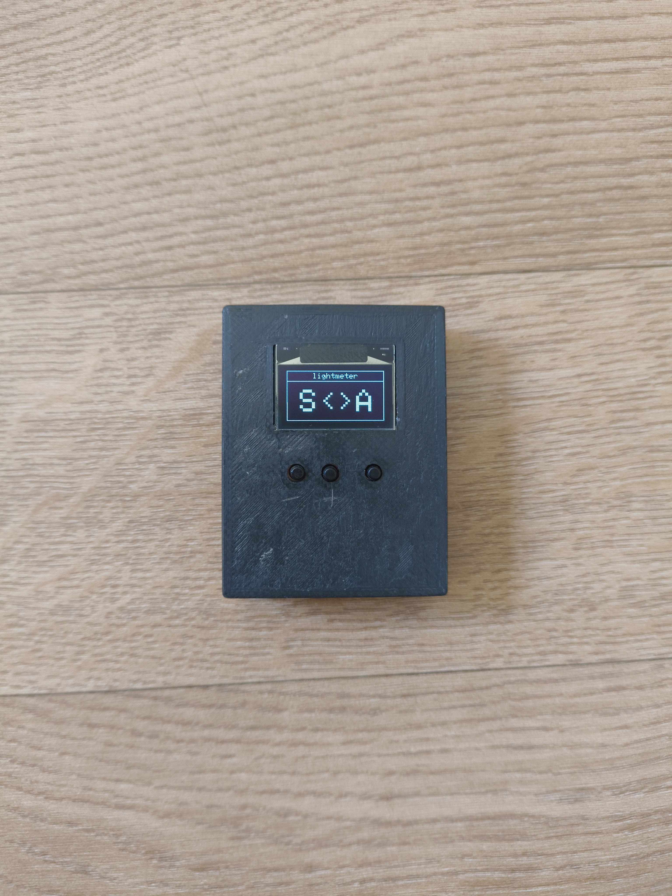
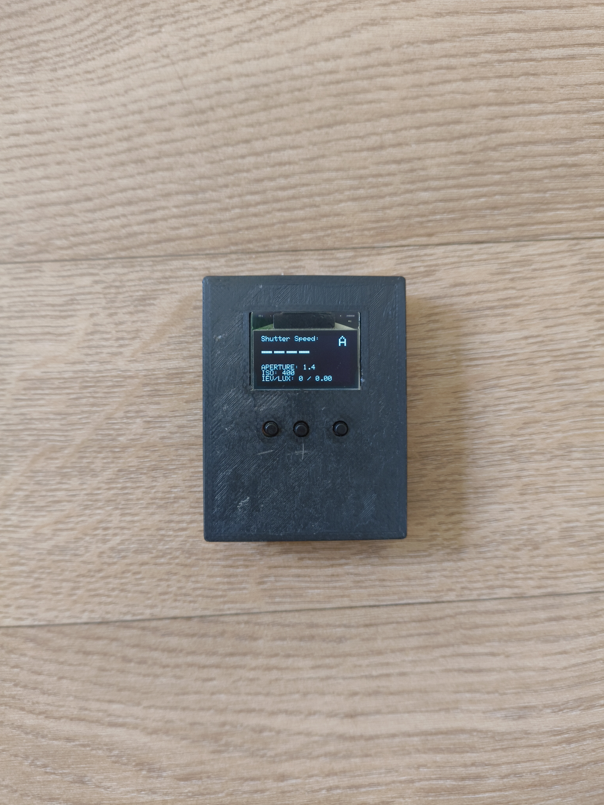

# lightmeter
An open hardware light meter designed for analog photography based on the TEMT6000 light sensor and an ATMEGA32u4.

  
  
  

Images of prototype.

### Project Goals
* Build a compact, accurate handheld light meter.
* Aperture and Shutter Priority modes.

## Details:
On boot pick a mode: - for Shutter Priority (S), + for Aperture Priority (A). The mode stays until reboot.

Aperture (or Shutter Speed in Shutter Priority) is changed by buttons on the left [-] and middle [+].
Reading is taken with the measure button in the right.
Holding the measure button and pressing +/- changes ISO.

Aperture, Shutter Speed and ISO are saved to EEPROM and restored on boot. ISO is shared between modes.
IEV & LUX are updated every 75ms.

IEV is a slightly modified version of EV to compensate for a more accurate exposure.
Rounding up after half of the required LUX for the next EV is being read.
Also this fixed the flickering of a 'borderline' EV.

### Licenses
* GNU GENERAL PUBLIC LICENSE Verson 3.0.
